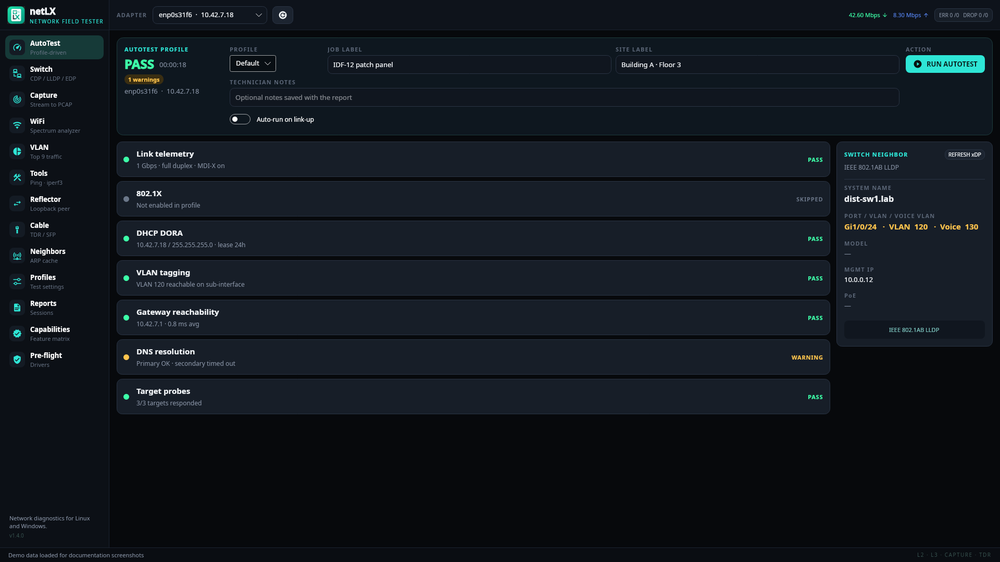
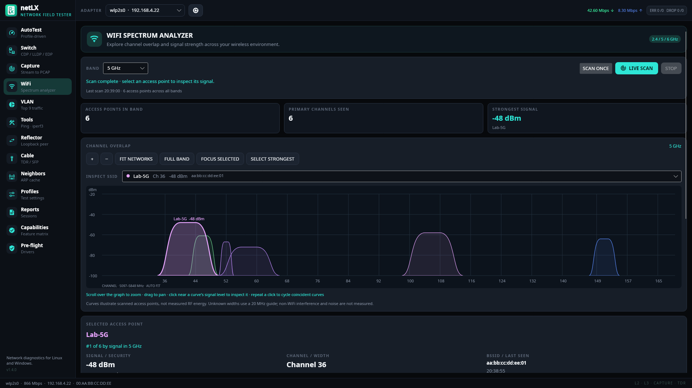
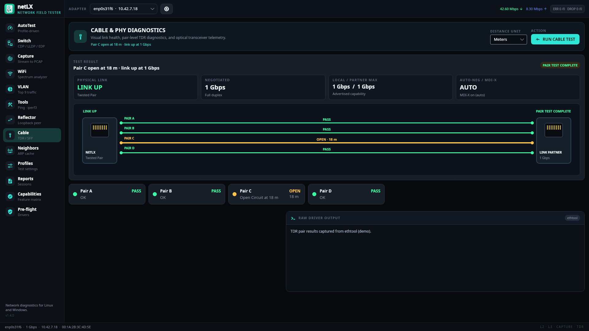
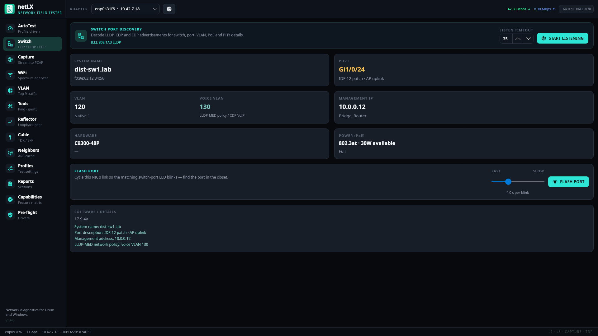
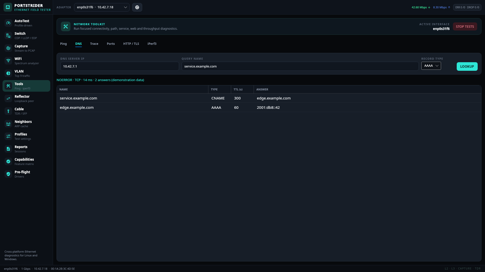
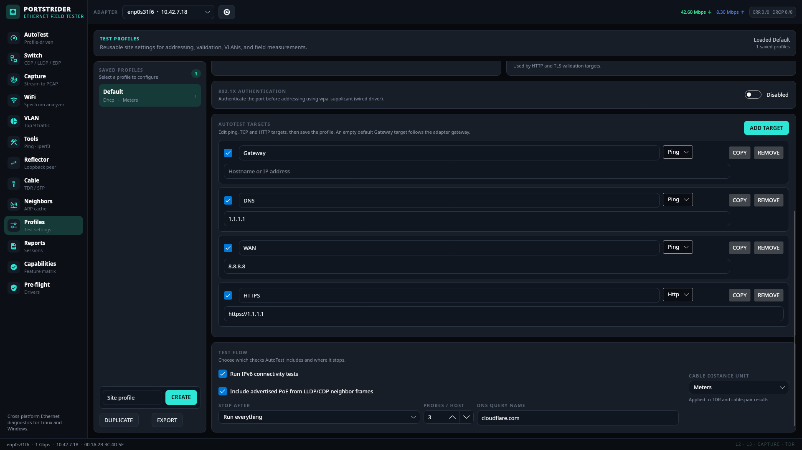

# PortStrider

Cross-platform Ethernet field tester for Linux and Windows. PortStrider brings LinkRunner-style diagnostics to a laptop: profile-driven AutoTest, switch discovery, packet capture, and local reporting — without a cloud dependency.

Built with **Avalonia 11** and **.NET 8**. Layer 2 work uses **SharpPcap** and **PacketDotNet**.

### What's new in v1.3

- **DNS diagnostics** — query A, AAAA, CNAME, NS, MX, TXT and PTR records directly, inspect TTLs, and retry truncated UDP replies over TCP. AutoTest shows DNS query and ICMP timings separately.
- **Editable AutoTest targets** — add, copy, remove, enable and validate ping, TCP and HTTP targets in Profiles.
- **More reliable probes** — source-bound Linux ping, IPv4/IPv6 TCP and HTTP connections; strict TLS validation, cancellation and clearer errors.
- **Accurate VLAN accounting** — top nine tagged VLANs, an Other VLANs bucket, and a separate Untagged row; shares use captured bytes.
- **Safer interface configuration** — refuse existing VLAN/address/route conflicts, restore original link settings, and stop AutoTest when configuration is incomplete.
- **Research and limitations** — [detailed LinkRunner G2 comparison and implementation audit](docs/linkrunner-g2-comparison.md).

The DHCP INFORM fix for already configured adapters from v1.2 remains included. Proxy and 802.1X passwords are omitted from exported profiles.

---

## Screenshots

| AutoTest | WiFi analyzer |
| --- | --- |
| [](docs/screenshots/01-autotest.png) | [](docs/screenshots/02-wifi.png) |
| Profile-driven link, DHCP, VLAN, gateway, DNS, and target checks with live switch discovery | 2.4 / 5 / 6 GHz overlap graph, band filters, live scans, and per-BSSID signal history |

| Cable diagnostics | Switch discovery |
| --- | --- |
| [](docs/screenshots/03-cable.png) | [](docs/screenshots/04-switch.png) |
| Visual link state, negotiated speed, four-pair TDR, and fault distance when the driver exposes it | LLDP / CDP / EDP decode, voice VLAN, PoE, and flash-port LED identification |

---

## Download

**[GitHub Releases](https://github.com/ClaudiuJitea/PortStrider/releases)** — latest: **v1.3.0**. Pick the asset for your platform:

| Platform | Release asset |
| --- | --- |
| Linux x64 | `PortStrider-linux-x64` |
| Linux arm64 | `PortStrider-linux-arm64` |
| Windows x64 | `PortStrider-win-x64.exe` |
| Windows arm64 | `PortStrider-win-arm64.exe` |

Verify checksums with `SHA256SUMS-supported` from the same release:

```bash
sha256sum -c SHA256SUMS-supported
```

Source-tree copies also live under [`publish/`](publish/) for cloning without using Releases.

On Linux, grant capture capabilities once after download (see [Linux capture privileges](#linux-capture-privileges)).

---

## Features

| Area | What it does |
| --- | --- |
| **AutoTest** | Profile-driven test sequence: link telemetry, 802.1X, DHCP DORA / INFORM with vendor options, VLAN, gateway/target reachability, DNS, advertised PoE; configurable stop point; continuous re-probe; auto-run on link-up |
| **Connect settings** | Applies MAC, forced speed/duplex, 802.1Q VLAN, and static IPv4 for the test, then rolls back (Linux) |
| **802.1X** | `wpa_supplicant -D wired` — PEAP, TTLS, TLS, MD5; port stays authorized for the rest of the test |
| **Switch** | LLDP, CDP, and EDP decode; Voice VLAN from LLDP-MED / CDP; Flash Port blinks the switch LED by cycling the link |
| **Reflector** | Swaps MAC (and optionally IP + ports) and re-injects; NetAlly interoperability is not certified |
| **VLAN monitor** | Top nine tagged VLANs by captured bytes, Other VLANs aggregation, and separate Untagged / priority-tagged traffic |
| **WiFi spectrum analyzer** | 2.4 / 5 / 6 GHz channel-overlap graphics, per-BSSID RSSI history, band filters, single/live scans, and nearby access-point details |
| **Capture** | Streaming PCAP with BPF filters, snap length, 2 GB cap |
| **Tools** | Ping, DNS record lookup, traceroute, bounded concurrent TCP port probes, HTTP/TLS, iperf3 client/server |
| **Cable** | TDR via ethtool when the driver exposes it; SFP EEPROM/DDM when available |
| **Reports** | Local JSON, CSV, PDF, ZIP bundles, attachments, search, duplicate/delete |
| **Capabilities** | Honest feature matrix — hardware-dependent items marked unavailable instead of faked |

---

## Quick start

### Run from source

```bash
dotnet restore
dotnet run --project PortStrider.UI
```

### Linux capture privileges

Do not run the whole GUI as root. After building:

```bash
chmod +x scripts/grant-caps.sh
./scripts/grant-caps.sh
```

This applies `cap_net_raw`, `cap_net_admin`, and `cap_net_bind_service` (UDP/68 for DHCP) to the `PortStrider` binary. Restart after granting capabilities. PortStrider prepares the first two already-granted capabilities in the launching thread's inheritable and ambient sets so child processes (`iw`, `ip`, `ethtool`, `wpa_supplicant`) inherit them. Network command helpers can fall back to passwordless `sudo -n` or `pkexec`; live WiFi scans report missing privileges without repeated password prompts. Pre-flight checks active network capabilities and inheritance, and distinguishes a saved grant that still needs a restart.

For a downloaded standalone binary, point the script at that path or run:

```bash
sudo setcap cap_net_raw,cap_net_admin,cap_net_bind_service+eip ./PortStrider
```

### Windows

1. Install [Npcap](https://npcap.com/#download) with WinPcap API-compatible mode.
2. Launch elevated if the NDIS filter refuses raw capture.

### External tools (optional)

Pre-flight checks list missing dependencies. Common ones:

- **Linux:** `ip`, `ethtool`, `wpa_supplicant`, `iperf3`, `ping`, `traceroute`, `iw` (WiFi scans)
- **Windows:** `iperf3` (Npcap required for capture)

### DHCP with an existing address

AutoTest refreshes the selected adapter before the DHCP step. If it already has a usable IPv4 address, PortStrider sends DHCP INFORM and waits for a matching server ACK. This checks the server and requests configuration options without replacing or renewing the OS lease. The result explicitly says lease acquisition was not tested. No response produces a warning, not a fabricated pass or a failed new-lease claim. Missing transport permissions produce an unavailable/skipped result.

Without a usable address (including a 169.254.x.x link-local address), AutoTest performs full DORA. The raw transport sends from 0.0.0.0 and captures replies on the selected interface while OS DHCP and switch discovery continue independently. Linux can fall back to UDP/68 if available; Windows requires Npcap. A temporary VLAN interface receives only an actual DORA lease, never an INFORM result.

### Authenticated proxies and IPv6

[View the updated profile editor](docs/screenshots/05-profiles.png).

In **Profiles**, enter an HTTP(S) proxy URL and optional username/password. AutoTest HTTP/TLS targets use these credentials when the proxy requests authentication. Passwords are stored in the local profile JSON and omitted from profile exports; re-enter them after import. The standalone Tools HTTP probe keeps its existing settings.

The IPv6 AutoTest card shows the adapter's link-local address alongside its global or unique-local address. A link-local-only adapter is reported as such, with global reachability untested. Linux ICMP binds the selected source through `iputils-ping`. Windows ICMP uses OS routing and produces a warning in AutoTest when the selected source cannot be enforced. DHCPv6 and router-advertisement analysis remain unimplemented.

### DNS and editable targets

Open **Tools → DNS**, enter a DNS server IP, a query name and a record type, then select **Lookup**. The table shows the relevant answers and TTLs; the status includes the server, response code, transport and duration. PTR queries take an `in-addr.arpa` or `ip6.arpa` name. NODATA and negative replies do not count as successful resolution. **Stop tests**, switching adapters or leaving Tools cancels active work.

In **Profiles → AutoTest targets**, edit destinations and labels, choose Ping/TCP/HTTP, and use **Add target**, **Copy**, **Remove**, or the enabled checkbox. Save the profile before running it. An empty original Gateway target follows the adapter gateway. HTTP URLs must use HTTP(S); credentials belong in the proxy fields. Exported profiles omit both proxy and 802.1X passwords; local profile storage remains clear text.

| DNS lookup | AutoTest target editor |
| --- | --- |
| [](docs/screenshots/06-dns.png) | [](docs/screenshots/07-targets.png) |

### Interface selection and temporary settings

TCP, direct DNS and HTTP connections bind the selected source address; Linux ICMP uses `ping -I`. IPv6 literals choose an IPv6 source. This is source binding, not a separate network namespace: kernel routes, hostname resolution, traceroute and iPerf still depend on host configuration. IPv4 is preferred for hostnames on dual-stack adapters; use an IPv6 literal or the explicit AAAA lookup to investigate IPv6 separately. Windows ICMP does not enforce the selected source.

Packet capture, discovery, VLAN monitoring and reflection require an exact, unambiguous capture-device match. An unavailable adapter never falls back to the first capture device. AutoTest stops if requested temporary settings or a temporary VLAN lease cannot be fully applied. Existing VLAN names, addresses and routes are not replaced; resolve conflicts or use the adapter defaults. Cleanup restores owned changes on completion/cancellation; a process crash or a driver refusing cleanup still requires manual inspection.

### WiFi spectrum analyzer

Select a WiFi adapter in the top toolbar and open **WiFi**. Choose a band and use **Scan once** or **Live scan**. The graph automatically fits the observed channel footprints. Scroll over it (or use +/−) to zoom, drag to pan, and use **Fit networks**, **Full band**, or **Focus selected** to adjust the view. Manual zoom is retained during live refresh. Click near a curve's signal level to inspect it; repeated clicks cycle coincident curves. You can also choose an SSID in the selector or access-point table. Colors match the curves, selector, and overlap list.

**Select strongest** chooses the highest RSSI in the current band. The details panel shows signal rank, BSSID, security, primary channel/frequency, width, estimated footprint, overlapping APs, same-primary-channel peers, last-seen time, and historical signal minimum/maximum/average. Ranking describes received signal only, not speed or Internet quality; overlap describes frequency footprints, not measured airtime. History follows the selected BSSID across the last 60 scans, including gaps when it disappears. Live scans wait five seconds after each completed sweep; Stop, changing adapters, and leaving the page cancel monitoring.

Pre-flight checks WiFi scan tools and adapter/radio availability. On Linux, repair **WiFi scan tools** to install `iw`; repair **Capture privileges** and restart the app to inherit CAP_NET_ADMIN for scanning. Enable WiFi and disable airplane mode. On Windows, scans use the native WLAN API and require WLAN AutoConfig, a working WiFi driver, and OS location access where required. Pre-flight reports failures with guidance; Npcap is not needed for this analyzer.

The graphs visualize access-point scan results, not raw RF spectrum: they cannot measure non-WiFi interference, noise floor, or airtime utilization. Available bands depend on the adapter, driver, and regulatory domain. Curves use advertised HT/VHT operating widths when parsed on Linux; unknown widths (including Windows and non-contiguous 80+80 MHz) use a labeled 20 MHz guide. Windows security is shown as Open/Protected. Failed scans retain the last completed result and timestamp.

### Cable diagnostics display

The Cable page summarizes physical link state, negotiated speed/duplex, local and partner advertised maximum speeds, auto-negotiation, MDI-X, and port media in visual cards. When a driver exposes TDR results, a four-pair cable diagram and colored pair cards show pass/open/short/check state and estimated fault distance. When the link works but the selected NIC does not expose TDR, the page shows a healthy link separately from an amber **TDR not exposed** result instead of presenting the driver error as a cable fault. Raw `ethtool` output remains available in a collapsed technical-details section.

Backend references: [Linux iw](https://wireless.docs.kernel.org/en/latest/en/users/documentation/iw.html), [Windows WLAN BSS API](https://learn.microsoft.com/en-us/windows/win32/api/wlanapi/nf-wlanapi-wlangetnetworkbsslist).

---

## Build release binaries

Single-file, self-contained publish per RID:

```bash
RID=linux-x64   # or linux-arm64, win-x64, win-arm64, osx-x64, osx-arm64
dotnet publish PortStrider.UI -c Release -r $RID \
  --self-contained true \
  -p:PublishSingleFile=true \
  -p:IncludeNativeLibrariesForSelfExtract=true \
  -p:EnableCompressionInSingleFile=true \
  -o publish/${RID}-standalone
```

Regenerate checksums:

```bash
(cd publish && sha256sum linux-*-standalone/PortStrider win-*-standalone/PortStrider.exe > SHA256SUMS-supported)
```

---

## Solution layout

```
PortStrider.sln
├── PortStrider.Core              Models and service contracts
├── PortStrider.Infrastructure    Capture, probes, profiles, reports, platform
├── PortStrider.UI                Avalonia MVVM shell (assembly: PortStrider)
├── PortStrider.Core.Tests
└── PortStrider.Infrastructure.Tests
```

---

## Capability matrix

| Feature | Linux | Windows | Notes |
| --- | --- | --- | --- |
| AutoTest / targets | Yes | Yes | Uses host adapter routing |
| LLDP / CDP / EDP | Yes | Yes | Needs libpcap/Npcap + privileges |
| Active DHCP (DORA / INFORM) | Yes | Yes | libpcap/Npcap + capture privileges; selected interface, independent of the OS DHCP socket. Linux has an interface-bound UDP fallback. |
| Advertised speed / MDI-X / downshift | Yes | Degraded | From `ethtool`; NDIS exposes actual speed only |
| Forced speed/duplex, user MAC, static IP | Yes | No | `ethtool -s`, `ip link`, `ip addr`; restored after test |
| VLAN tagging test | Yes | No | Temporary 802.1Q sub-interface |
| 802.1X test | Yes | No | `wpa_supplicant -D wired` |
| Voice VLAN | Yes | Yes | LLDP-MED Network Policy, CDP VoIP VLAN |
| Flash switch-port LED | Yes | No | Cycles link with `ip link` |
| Packet reflector | Yes | Yes | MAC or MAC+IP swap; needs capture privileges |
| Loaded PoE measurement | No | No | Advertised PoE from neighbor TLVs only |
| Cable TDR | Degraded | No | Driver-dependent ethtool |
| Wiremap / tone | No | No | Requires dedicated hardware |
| SFP diagnostics | Degraded | No | `ethtool -m` when exposed |
| Packet capture | Yes | Yes | Streams to PCAP |
| WiFi channel / signal analyzer | Yes | Yes | WiFi adapter required; Linux iw + CAP_NET_ADMIN; Windows native WLAN; scan data, not raw RF spectrum |
| iperf3 throughput | Yes | Yes | External binary |
| Local reports / bundles | Yes | Yes | No cloud dependency |

---

## Tests

```bash
dotnet test PortStrider.sln
```

---

## License

Source and binaries are provided as-is for field testing and evaluation. Add a `LICENSE` file if you intend to distribute under a specific open-source terms.
