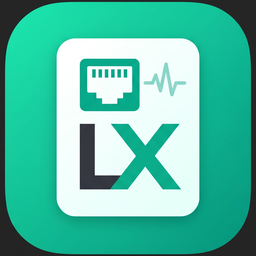
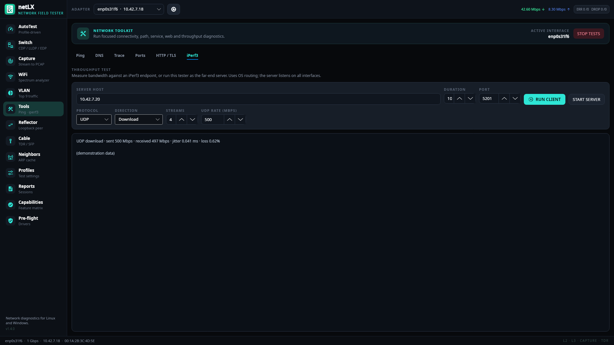

<div align="center">



# netLX

**A network field tester for Linux and Windows laptops.**

Profile-driven AutoTest, switch discovery, packet capture, WiFi analysis, cable checks
and throughput tests — with local reports and no cloud dependency.

[](https://github.com/ClaudiuJitea/netLX/releases/latest)


[Download](#install) · [Features](#features) · [Screenshots](#screenshots) · [Build](#build-from-source) · [Release notes](docs/release-v1.4.0.md)

<br>


</div>

## Why netLX?

- **One-click AutoTest.** Link, 802.1X, DHCP, VLAN, gateway, DNS and target checks are driven by reusable profiles.
- **See the switch port.** LLDP, CDP and EDP decoding shows the switch name, port, VLAN, voice VLAN and PoE.
- **Results you can trust.** Tests bind to the selected adapter where the OS allows it. Features the hardware can't support show as unavailable; netLX doesn't fake a pass.
- **Runs locally.** Reports are stored on your machine and export to JSON, CSV, PDF or a ZIP bundle.

## Features

| Area | Highlights |
| --- | --- |
| **AutoTest** | Link telemetry · 802.1X · DHCP DORA/INFORM · VLAN · gateway/targets · DNS · advertised PoE · stop point · auto-run on link-up |
| **Switch** | LLDP / CDP / EDP decode, voice VLAN (LLDP-MED, CDP), flash-port LED identification |
| **Capture & VLAN** | Streaming PCAP with BPF filters; top-nine VLAN traffic monitor with Other and Untagged buckets |
| **WiFi** | 2.4 / 5 / 6 GHz channel-overlap graph, per-BSSID RSSI history, live scans |
| **Cable** | Link/PHY summary, four-pair TDR and fault distance when the driver exposes it, SFP DDM |
| **Tools** | Ping, DNS lookup (A/AAAA/CNAME/NS/MX/TXT/PTR), traceroute, port scan, HTTP/TLS, **iPerf3 TCP/UDP, upload/download/bidirectional, parallel streams** |
| **Reflector** | MAC or MAC+IP swap loopback peer |
| **Profiles & reports** | Editable targets, temporary MAC/speed/VLAN/static IP with rollback, profile and report-bundle **import/export**, multi-page PDF |

See the [capability matrix](#platform-support) for what each OS supports, and the
[implementation audit](docs/linkrunner-g2-comparison.md) for scope and known limits.

## Screenshots

| WiFi analyzer | Cable diagnostics |
| --- | --- |
| [](docs/screenshots/02-wifi.png) | [](docs/screenshots/03-cable.png) |
| **Switch discovery** | **iPerf3 throughput** |
| [](docs/screenshots/04-switch.png) | [](docs/screenshots/08-iperf.png) |
| **DNS lookup** | **AutoTest targets** |
| [](docs/screenshots/06-dns.png) | [](docs/screenshots/07-targets.png) |

## Install

Download the latest build from **[Releases](https://github.com/ClaudiuJitea/netLX/releases/latest)**:

| Platform | Asset |
| --- | --- |
| Linux x64 / arm64 (recommended) | `netLX-<version>-linux-x64.tar.gz` / `…-linux-arm64.tar.gz` — binary, icon, desktop entry and installer |
| Linux x64 / arm64 (binary only) | `netLX-linux-x64` / `netLX-linux-arm64` |
| Windows x64 / arm64 | `netLX-win-x64.exe` / `netLX-win-arm64.exe` |

Verify downloads with `sha256sum -c SHA256SUMS --ignore-missing`.

**Linux**

```bash
tar xzf netLX-*-linux-x64.tar.gz && cd netLX-*-linux-x64
./install-linux.sh        # installs to ~/.local, adds a menu entry, grants capture capabilities
```

The installer applies `cap_net_raw,cap_net_admin,cap_net_bind_service` so that capture, DHCP and WiFi scans work without running the GUI as root. To do this by hand on the standalone binary, run `sudo setcap cap_net_raw,cap_net_admin,cap_net_bind_service+eip ./netLX`, then restart netLX. Pre-flight reports missing tools: `ip`, `ethtool`, `wpa_supplicant`, `iperf3`, `traceroute`, `iw`.

**Windows**

Install [Npcap](https://npcap.com/#download) with WinPcap-compatible mode. Run netLX elevated if the NDIS filter refuses raw capture. Pre-flight can download `iperf3`.

## Platform support

| Feature | Linux | Windows | Notes |
| --- | :---: | :---: | --- |
| AutoTest, targets, DNS, HTTP/TLS | ✅ | ✅ | Windows ICMP can't enforce the source address |
| LLDP / CDP / EDP, voice VLAN, capture, reflector | ✅ | ✅ | libpcap/Npcap + capture privileges |
| Active DHCP (DORA / INFORM) | ✅ | ✅ | INFORM when the adapter already has an address; never replaces the OS lease |
| WiFi channel / signal analyzer | ✅ | ✅ | Linux `iw` + CAP_NET_ADMIN; Windows native WLAN API |
| iPerf3 client / server | ✅ | ✅ | External `iperf3` binary; OS routing |
| Forced speed/duplex, MAC, static IP, VLAN, 802.1X | ✅ | — | `ethtool`, `ip`, `wpa_supplicant`; restored after the test |
| Advertised speed / MDI-X / downshift | ✅ | ◐ | NDIS exposes actual speed only |
| Cable TDR, SFP diagnostics | ◐ | — | Depends on driver support in `ethtool` |
| Loaded PoE, wiremap, tone | — | — | Needs dedicated hardware; netLX shows advertised PoE only |

✅ supported · ◐ hardware/driver dependent · — not available

## Build from source

Requires the [.NET 8 SDK](https://dotnet.microsoft.com/download/dotnet/8.0).

```bash
dotnet run --project NetLX.UI          # run
dotnet test NetLX.sln                  # tests
./scripts/build-release.sh             # self-contained binaries + archives in dist/
```

For a development build on Linux, `scripts/grant-caps.sh` applies capture capabilities to the debug binary.

```
NetLX.Core               models and service contracts
NetLX.Infrastructure     capture, probes, platform integration, profiles, reports
NetLX.UI                 Avalonia MVVM application (assembly: netLX)
NetLX.*.Tests            xUnit suites
tools/ReadmeScreenshots  headless renderer for the images above
```

## Data locations

Profiles and sessions are stored in `~/.local/share/netLX` (Linux) or `%LOCALAPPDATA%\netLX` (Windows). Exports and captures go to `~/netLX`. Profile exports don't include proxy or 802.1X passwords.

## Part of the LX family

[compositorLX](https://github.com/ClaudiuJitea/compositorLX) (image editing) · [pdfLX](https://github.com/ClaudiuJitea/pdfLX) (PDF editing) · **netLX** (network testing)
